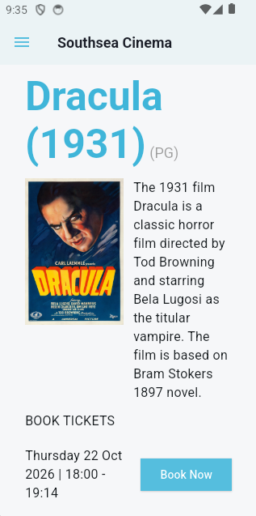
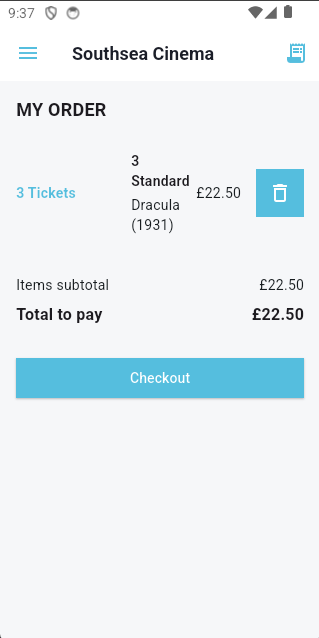

# Southsea Cinema

A Flutter app for browsing Southsea Cinema films and booking tickets.

## Features

- Browse films with descriptions, age ratings, showtimes and prices
- Select from one to five adult tickets for a film
- Add tickets to a basket and remove items
- Check out and save orders locally with SQLite
- View saved order details
- Save customer profile and newsletter settings
- Switch between light and dark themes
- Navigate using the menu

The app currently supports Android only.

## Screenshots

### Menu



### Basket




## Install dependencies

Install Flutter and Android Studio, then open an Android emulator.

From the project folder, run:

```bash
flutter pub get
```

## Run on an Android emulator

Start an emulator in Android Studio.

Check that Flutter can see the emulator:

```bash
flutter devices
```

Run the app:

```bash
flutter run -d emulator-5554
```

Replace `emulator-5554` with the device ID shown by `flutter devices`.

## Run the tests

Run all tests with:

```bash
flutter test
```
